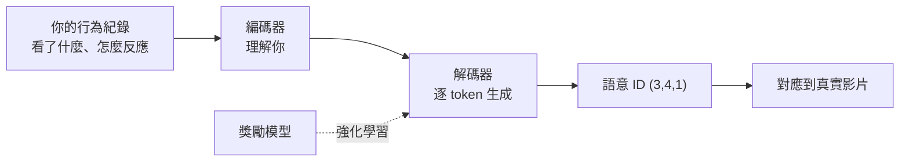

# 生成式推薦（Generative Recommendation）

**一句話定義**：用類似 ChatGPT「接龍」的方式做推薦。把你的行為紀錄當成一段「句子」，讓模型預測下一個「字」。這個「字」可以是你接下來會看的影片，也可以是你對某支影片的反應。

## 白話解釋

**比喻：手機輸入法的自動完成。**
- 你打「今天天氣」，輸入法猜下一個詞是「很好」。
- 生成式推薦也一樣：你的紀錄是「看了貓咪影片 → 看完 → 看了狗狗影片 → 按讚 → …」，模型猜下一步是「鸚鵡影片」。

傳統推薦比較像「**考選擇題**」：先由召回挑出幾百個選項，再對每個選項打分。
生成式推薦比較像「**寫申論題**」：直接寫出答案。

## 為什麼需要它

- **傳統模型加算力也不會變好**：Meta 指出，業界的深度推薦模型（DLRM）大多無法隨算力擴展，大約 2000 億參數就飽和（[[sources/hstu]], p.1, p.8）。
- **想搭上大型語言模型的技術紅利**：scaling law、強化學習在語言模型上很成功，但傳統多階段架構很難套用（[[sources/onerec]], p.3）。
- **少一點人工特徵**：HSTU 拿掉了大量人工設計的數值特徵，讓模型自己從行為序列學（[[sources/hstu]], §2.1, p.2）。

## 怎麼運作

### HSTU（Meta, 2024）

- **把行為排成序列**：內容₀、反應₀、內容₁、反應₁…（[[sources/hstu]], Table 1, p.3）
- **排序** = 預測「你對下一則內容的反應」。
- **召回** = 預測「你下一個會喜歡的內容」。
- 架構是改良版的 Transformer（HSTU 層），見 [[concepts/transformer]]。

### OneRec（快手, 2025）

1. **影片變成語意 ID**：每支影片編成 3 個由粗到細的 token，例如 (3, 4, 1)，相似影片的前綴相同（[[sources/onerec]], §2.1, p.5–7）。
2. **編碼器**讀你的歷史，**解碼器**逐個 token「寫出」推薦影片（§2.2–2.3, p.7–10）。
3. **強化學習**：用獎勵模型評分，鼓勵模型生成「好的」推薦（§2.4, p.10–13）。

（依 [[sources/onerec]], Figure 2, p.4 簡化）

## 和傳統推薦的比較

| 面向 | 傳統（YouTube 2016 型 DLRM） | 生成式（HSTU、OneRec） |
|---|---|---|
| 問題形式 | 對每個候選打分（[[sources/youtube-dnn-2016]], p.2） | 序列接龍：預測下一個 token |
| 特徵 | 數百到上萬個人工特徵 | 主要是原始行為序列 |
| 架構 | 多個專用模組串接 | 單一 Transformer 類模組 |
| 加大模型 | 很快飽和 | 符合 scaling law（[[concepts/scaling-law]]） |
| 多階段漏斗 | 必須 | HSTU 仍分召回和排序；OneRec 主張端到端取代 |

## ⚠️ 注意

- **生成式 ≠ 用 ChatGPT 推薦**。HSTU 和 OneRec 都是從頭訓練的**行為模型**，不是拿現成的語言模型來推薦。HSTU 指出，以語言模型做推薦的研究在大規模情境下「還沒有贏過協同過濾」（[[sources/hstu]], p.9）；OneRec 也說還沒整合 LLM（[[sources/onerec]], p.25）。
- **生成的東西可能不存在**：OneRec 加入強化學習後，超過一半生成的 ID 對不到真實影片，需要額外的格式獎勵修正（[[sources/onerec]], p.12–13, p.21）。這和語言模型的「幻覺」很像（🧭 wiki 觀點的類比）。
- 兩篇都是**平台自己報告**的成效。

## 相關

- [[concepts/transformer]]、[[concepts/scaling-law]]、[[concepts/recommendation-funnel]]、[[syntheses/cascade-vs-end-to-end]]、[[teaching/autocomplete-analogy]]
