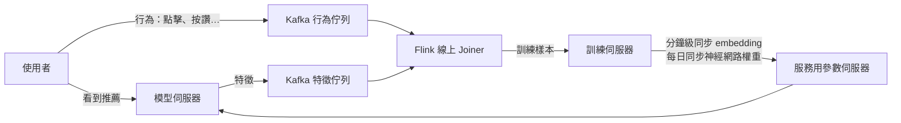

# 即時／線上訓練與概念漂移（Online Training & Concept Drift）

**一句話定義**：使用者的興趣一直在變，這叫**概念漂移（concept drift）**。所以模型上線後不停止學習，而是一邊服務一邊用最新的行為更新自己，這叫**線上訓練（online training）**。

## 白話解釋

**比喻：天氣預報員。**
- 只用去年的資料做預報（**批次訓練**），遇到今天突然來的颱風就會失準。
- 好的預報員會每小時看最新的雷達圖，隨時修正預報（**線上訓練**）。

你在 TikTok 上連看三支貓咪影片後，接下來很快出現更多貓咪影片，背後就是類似的機制。（⚠️ 這個例子是教學比喻；Monolith 論文沒有說它用於 TikTok，見 [[entities/bytedance]]。）

## 為什麼需要它

- **興趣變化很快**：Monolith 說，視覺和語言模式要以世紀為尺度才會改變，同一個使用者對某個主題的熱情卻可能下一分鐘就轉移（[[sources/monolith]], §1.2, p.2）。
- **模型天生偏向過去**：YouTube 指出，機器學習系統用歷史資料預測未來，因此有「偏向過去的隱性偏誤」（[[sources/youtube-dnn-2016]], §3.3, p.3）。
- **新內容一直出現**：YouTube 每秒有好幾小時的影片上傳（[[sources/youtube-dnn-2016]], p.1）。

## 兩種對策

| 對策 | 來源 | 怎麼做 |
|---|---|---|
| 把「時間」當特徵 | [[sources/youtube-dnn-2016]], §3.3, p.3 | 訓練時輸入「樣本年齡」，上線時設成 0，讓模型知道「現在」是訓練窗口的最尾端 |
| 線上訓練 | [[sources/monolith]], §2.2, p.4–5 | 模型上線後持續吃即時資料，並以分鐘級間隔把更新推到線上 |

## Monolith 的線上訓練怎麼運作

（依 [[sources/monolith]], Figure 4, p.4 簡化）

- 只同步**被更新過**的 embedding，所以傳輸量小。估算每分鐘約 400MB（p.5, p.9）。
- 神經網路權重變化慢，每天同步一次就夠了（p.5, p.9）。

## 成效（作者報告）

- Criteo 資料集上，同步間隔越短 AUC 越高：5 小時 79.66 → 1 小時 79.78 → 30 分鐘 79.80；只做批次訓練約 79.42–79.44（[[sources/monolith]], Table 2, p.8）。
- 正式廣告模型的 A/B 測試：AUC「提升 14–18%」（Table 3, p.9）。⚠️ 論文沒有定義怎麼計算，引用時要保守。

## 生成式模型也是串流訓練

- HSTU 指出，業界推薦模型「通常以串流方式訓練」，資料一進來就處理（[[sources/hstu]], §2.3, p.3）；整份論文的工業實驗也都是單次串流設定（p.6）。
- OneRec 的後訓練用即時資料流做線上訓練（[[sources/onerec]], §3.3, p.15）。

## 取捨

- **可靠性換即時性**：Monolith 每天只做一次快照，故障時最多損失一天的更新，作者認為影響可以接受（[[sources/monolith]], p.6, p.9）。
- 系統複雜度大增：需要串流平台、即時配對樣本、增量同步參數。

## 相關

- [[concepts/embedding]]、[[concepts/ranking]]、[[concepts/ab-testing]]、[[entities/bytedance]]
