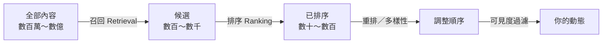

# 推薦漏斗／多階段管線（Recommendation Funnel）

**一句話定義**：推薦系統不會一次把幾億則內容全部仔細打分，而是分好幾關逐步篩選：先粗略撈出幾百到幾千則候選（[[concepts/retrieval|召回]]），再精細打分（[[concepts/ranking|排序]]），最後做多樣性調整和安全過濾，才送到你的畫面上。

## 白話解釋

**比喻：選秀節目。**
- **海選（召回）**：幾百萬人報名，評審不可能每個人都看完整表演，所以先用快速規則刷掉大多數人，例如只看 10 秒影片、看類型符不符合。
- **複賽（排序）**：剩下幾百人，評審仔細看每個人的完整表演，打出詳細分數。
- **決賽編排（重排與過濾）**：最後上電視的十幾個人，還要考慮節目節奏（不要連續三個都唱情歌）和節目規範（不能播出不當內容）。

所以每一關都在「速度」和「準確度」之間取捨：前面的關卡快但粗，後面的關卡慢但細。

## 為什麼需要它

- 內容量太大：YouTube 有**數百萬**支影片，要在**數十毫秒**內回應（[[sources/youtube-dnn-2016]], p.2–3）。
- 精細模型很貴：每多算一則內容都要時間和運算資源，不可能對全部內容都用最複雜的模型。
- 分階段還有一個好處：可以**混入多種候選來源**，例如追蹤的人、熱門內容、相似使用者喜歡的內容（[[sources/youtube-dnn-2016]], p.2；[[sources/x-algorithm]], #Overview）。

## 怎麼運作

| 階段 | YouTube 2016 | X 2026 |
|---|---|---|
| 召回 | 候選生成網路，數百萬 → 數百（p.2） | Thunder（追蹤中）＋ Phoenix 雙塔 ＋ SimClusters ＋ 熱門貼文（#Overview） |
| 排序 | 預測觀看時間的深度網路（p.5） | Phoenix Transformer 預測多種行為的機率再加權（#Scoring and Ranking） |
| 重排／多樣性 | 曝光頻率特徵讓列表有變化（p.6） | 作者多樣性衰減、DPP 重排（#Scoring and Ranking, #Components） |
| 過濾 | 論文未討論 | 前置過濾器 ＋ 選取後的可見度過濾（#Filtering） |

TikTok 2020 年的說明沒有描述管線架構（[[sources/tiktok-foryou]], p.2–3）。後來的官方說明頁則明確寫出五個步驟：挑選影片 → 預測 → 排序 → 相似度檢查 → 推薦規則。流程圖上的規模是**數百萬 → 數千**（[[sources/tiktok-transparency]], p.6–8, p.12）。

## 在各來源中的樣貌

- [[sources/youtube-dnn-2016]]：明確提出「漏斗（funnel）」的說法，見 Figure 2（p.2）。
- [[sources/x-algorithm]]：七步驟的 Post Pipeline，外面再包一層混排廣告的 Blending Pipeline（#Request Path）。
- [[sources/tiktok-foryou]]：沒有說明架構，只描述排序因素（p.1–2）。
- [[sources/tiktok-transparency]]：五步驟，外加「所有上傳影片先審核」這一關（p.9, p.12）。

## 新挑戰：端到端生成

- 快手的 OneRec 主張用**一個生成模型**取代整個漏斗，理由是算力碎片化和各階段目標衝突（[[sources/onerec]], p.3–4）。
- Meta 的 HSTU 則保留召回和排序兩個任務，但都改用生成式方法（[[sources/hstu]], Table 1, p.3）。
- 爭議整理見 [[syntheses/cascade-vs-end-to-end]]。

## 相關

- [[concepts/generative-recommendation]]、[[concepts/retrieval]]、[[concepts/ranking]]、[[concepts/diversity-and-exploration]]、[[concepts/visibility-filtering]]、[[teaching/funnel-analogy]]、[[syntheses/platform-pipeline-comparison]]
